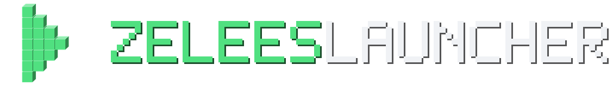

<div align="center">



# ZeleesLauncher

**Лёгкий лаунчер Minecraft: Java Edition на Python**

Вход через Microsoft · все версии и загрузчики · автоподбор Java · скины с 3D-редактором · моды · автообновление с цифровой подписью

[Скачать](https://zelees.link) · [Как собрать](#сборка-установщика) · [Обновления](#как-работают-обновления)

</div>

---

Лёгкий лаунчер Minecraft: Java Edition на Python. Не требует сторонних библиотек — нужен только Python 3.8+ (с tkinter, он ставится по умолчанию).

## Интерфейс

Тёмный минималистичный дизайн с собственной пиксельной графикой:

- **Главный экран** — большая пиксельная сцена, которая меняется по времени суток (день, закат, ночь), крупное название выбранной версии, статус Java и кнопка «Играть».
- **Боковая панель** с пиксельными иконками: Играть · Версии · Java · Опции · Консоль.
- **Аватар**: голова вашего скина (пока она грузится, показывается пиксельное лицо по нику).
- Скруглённые кнопки, переключатели, слайдер памяти, цветные кубики-метки для релизов, снапшотов, Beta и Alpha.
- Чёткая картинка на любом масштабе Windows (100–200 %).

Все картинки лежат в `launcher\assets.zip` и сгенерированы скриптом `tools\make_assets.py` (нужен Pillow, только если захотите их перерисовать).

## Скин и плащ

Вкладка **«Скин»** (для лицензионного аккаунта):

- **3D-модель персонажа**: крутится сама, её можно вращать мышью, есть кнопки «Спереди» и «Сзади». Показываются второй слой скина и плащ.
- **Загрузить PNG…**: перед применением скин можно посмотреть на модели, модель («Классическая» или «Тонкие руки») определяется автоматически.
- **Классическая модель / Тонкие руки**: модель текущего скина меняется в один клик.
- **Стандартный скин**: сброс на стандартный.
- **Мои скины**: библиотека. Сюда попадают загруженные скины и автоматически сохраняется ваш прежний скин, поэтому к нему всегда можно вернуться. Правый клик по скину убирает его из библиотеки.
- **Плащ**: все плащи аккаунта с миниатюрами, «Без плаща» снимает плащ.

Изменения сохраняются через официальный API Minecraft, и их видят все игроки (в игре — после перезахода). Без входа в аккаунт Microsoft показывается сгенерированный персонаж.

### Редактор скинов

Кнопка **«Создать скин»** или **«Редактировать текущий»** на вкладке «Скин». Двойной клик по скину в «Моих скинах» открывает его в редакторе.

- Рисовать можно **на развёртке 64×64** (при наведении видно, какая это часть тела) **и прямо на 3D-модели**: левая кнопка мыши рисует, правая вращает модель.
- **Слой 1 / Слой 2 · одежда**: на 3D можно рисовать по второму слою (куртки, шапки, очки). Пустые места второго слоя показаны полупрозрачной сеткой.
- Инструменты: карандаш (B), ластик (E), пипетка (I), заливка (G, заливает только одну грань), «Светлее», «Темнее» и «Шум» для живой фактуры.
- Палитра с тонами кожи и волос, выбор любого цвета и недавние цвета.
- Отменить и вернуть: Ctrl+Z / Ctrl+Y.
- Начать можно с манекена, текущего скина, случайного персонажа или PNG-файла. Модель — классическая или с тонкими руками.
- **«Сохранить»** кладёт скин в «Мои скины». **«Сохранить и надеть»** сразу ставит его на лицензионный аккаунт. Без входа скин можно нарисовать и сохранить в библиотеку.

## Логотип

Знак — кнопка «Играть», собранная из объёмных блоков. Надпись набрана собственным пиксельным шрифтом. Файлы лежат в папке `branding\`: значки для приложения, горизонтальная версия для тёмного и светлого фона, лист с правилами (`logo_sheet.png`). `ZeleesLauncher.ico` используется как иконка exe. Перерисовать логотип можно скриптом `tools\logo.py`.

## Моды

Вкладка **«Моды»** в боковой панели.

1. **Создайте сборку**: «+ Новая сборка» → версия Minecraft → загрузчик (**Fabric, Quilt, Forge или NeoForge**). Рекомендуемая версия загрузчика подставляется сама. Fabric и Quilt ставятся за секунды. Для Forge и NeoForge лаунчер скачает их официальный установщик и запустит его сам (1–3 минуты).
2. **Каталог**: поиск по Modrinth. Показываются только моды, у которых есть версия под ваш Minecraft и загрузчик. Кнопка **«Скачать»** кладёт мод в папку сборки и **автоматически докачивает обязательные зависимости** (например, Fabric API).
3. **Установленные**: каждый мод проверяется на совместимость:
   - по базе Modrinth (версия игры и загрузчик);
   - для модов, скачанных вручную с любых сайтов, — по метаданным внутри jar (`fabric.mod.json`, `quilt.mod.json`, `mods.toml`, `neoforge.mods.toml`, `mcmod.info`): мод не для того загрузчика, не та версия Minecraft;
   - **недостающие зависимости** (кнопка «Доустановить»);
   - доступные **обновления** (кнопка «Обновить»);
   - моды можно отключать переключателем (файл переименовывается в `.jar.disabled`) и удалять.
4. Перед запуском лаунчер ещё раз быстро проверяет моды и пишет предупреждения в «Консоль».

У каждой сборки своя папка: `data\minecraft\instances\<сборка>\` (моды, миры, настройки), поэтому моды разных версий не смешиваются.

**CurseForge**: их API работает только с личным ключом. Получите бесплатный ключ на console.curseforge.com и вставьте его в «Опции → CurseForge API-ключ». После этого в каталоге появится переключатель CurseForge. Некоторые авторы запрещают скачивание своих модов из сторонних лаунчеров. В этом случае лаунчер предложит открыть страницу мода.

## Сервера и Premium

Вкладка **«Сервера»**: список серверов игроков ZeleesLauncher. У каждого видны иконка, описание или MOTD, версия, **онлайн** и **пинг** от вашего компьютера (SRV-записи поддерживаются). Кнопка **«Играть»** запускает игру и сразу подключает к серверу: в 1.20+ через `--quickPlayMultiplayer`, в старых версиях через `--server/--port`. Если сервер работает на другой версии, лаунчер предложит переключиться на неё.

**Premium** (100 ₽ в месяц) привязан к лицензионному аккаунту Microsoft по UUID. С ним можно добавить до 3 своих серверов в общий список, а рядом с ником на главном экране появляется золотой значок **★ Premium**. Окно Premium открывается из меню аккаунта или кликом по значку. Когда Premium заканчивается, сервера владельца скрываются из списка, а при продлении появляются снова.

Как это устроено:
- Вход на сайт устроен как на обычном сервере Minecraft: лаунчер делает `join` в sessionserver Mojang, а сайт проверяет его через `hasJoined`. **Токен Minecraft на сайт не передаётся.**
- Соединение с сайтом идёт по HTTPS: через домен и запасной адрес с закреплённым корневым сертификатом (он вшит в `launcher/premium.py`).
- Серверная часть сайта (Premium, список серверов, оплата) в этом репозитории не публикуется.

## Возможности

- **Все версии Minecraft** из официального манифеста Mojang: от `rd-132211` (2009) и Alpha/Beta до последних релизов и снапшотов. Фильтры по типу, поиск, отметка установленных.
- **Аккаунт Microsoft (лицензия)**: полноценный вход Microsoft → Xbox Live → XSTS → Minecraft Services с проверкой, что игра куплена. Токен обновляется автоматически, повторно входить не нужно.
- **Только лицензия**: играть можно лишь с аккаунтом Microsoft, на котором куплен Minecraft: Java Edition. Оффлайн-режима нет, а оффлайн-аккаунты из старых версий лаунчера при запуске удаляются.
- **Проверка Java**: лаунчер читает из файла версии, какая Java нужна (8 / 16 / 17 / 21 / 25…), ищет установленные Java (PATH, JAVA_HOME, реестр, Program Files, Adoptium, Zulu, Microsoft, Corretto, Java из официального лаунчера и т. д.) и показывает, подходит ли она. Если подходящей нет — **автоматически скачивает официальную Java от Mojang**.
- Загрузка в 16 потоков с проверкой SHA1, докачка только недостающих файлов.
- Старые версии: распаковка natives, legacy/virtual-ассеты, `resources` для версий до 1.6.
- Модифицированные версии: Fabric/Forge/Quilt, установленные их установщиками в папку `data\minecraft\versions` (поддерживается `inheritsFrom`).
- Настройки памяти, размера окна, аргументов JVM, отдельных папок для каждой версии; консоль игры с подсветкой ошибок.

## Запуск

1. Установите Python 3 (если ещё нет): `winget install -e --id Python.Python.3.12` или с python.org (галочка «Add python.exe to PATH»).
2. Дважды щёлкните **`start.bat`**.
3. Войдите через Microsoft, выберите версию, нажмите **ИГРАТЬ**.

`debug.bat` — запуск с консолью, если что-то не открывается. Ошибки также пишутся в `data\launcher.log` и `data\crash.log`.

## Вход через Microsoft

Вход идёт через собственное приложение ZeleesLauncher (Azure), одобренное Mojang. Client ID вшит в `launcher/auth.py` (`AZURE_CLIENT_ID`). Нажмите «Войти» — откроется браузер, после входа в аккаунт Microsoft лаунчер сам получит данные и проверит лицензию. Копировать ссылки не нужно.

Настройки приложения в Azure: платформа «Mobile and desktop», redirect URI `http://localhost`, только личные учётные записи, включено «Allow public client flows».

Запасной вход по ссылке (кнопка «Войти по ссылке», если не открывается браузер): войдите на открывшейся странице, скопируйте адрес пустой страницы (Ctrl+L, Ctrl+C), лаунчер сам заметит ссылку в буфере обмена. Для кнопки «Войти во встроенном окне» запустите `install_webview.bat`. Аккаунты, добавленные этим способом раньше, продолжают работать и обновляться, повторный вход не нужен.

Если нужно использовать другое приложение Azure, впишите его Client ID в **Настройки → Microsoft Client ID**.

> Refresh-токен Microsoft хранится локально в `data\accounts.json`. На Windows файл зашифрован DPAPI: прочитать его может только тот же пользователь Windows на том же ПК (при переносе портативной папки на другой ПК аккаунты нужно добавить заново).

## Установщик и обновления

### Окно
Своя тёмная полоса заголовка вместо системной рамки: перетаскивается мышью (работает прилипание к краям экрана), есть кнопки «свернуть» и «закрыть», в Windows 11 углы скруглены. Окно остаётся на панели задач и в Alt+Tab.

### Сборка установщика
```
build_release.bat 1.0.0 "Первый релиз"
```
Скрипт сам поставит PyInstaller и Inno Setup (через winget), соберёт программу, уберёт лишние файлы и сделает в папке `release`:
- `ZeleesLauncher-Setup-1.0.0.exe` — установщик для пользователей;
- `zelees-app-1.0.0.zip` и `update.json` — для обновлений.

Установщик ставит лаунчер в `%LOCALAPPDATA%\Programs\ZeleesLauncher` без прав администратора. Он создаёт ярлыки в «Пуске» и (по желанию) на рабочем столе, а при удалении спрашивает, удалять ли игры и настройки. Данные установленной версии лежат в `%APPDATA%\ZeleesLauncher`.

### Как работают обновления
Установленный лаунчер при запуске проверяет `update.json`. Если версия новее, на главном экране появляется кнопка **«Доступно обновление»**. Проверить вручную можно в «Опциях».

- **Обычное обновление** (изменился код или картинки): скачивается пакет примерно 1 МБ, лаунчер перезапускается — и всё. Переустанавливать не нужно.
- **Если изменился сам exe** (новая версия Python и т. п.): увеличьте `BOOTSTRAP_VERSION` в `main.py`, соберите через `build_release.bat` и опубликуйте с `--min-bootstrap` равным этому числу. Старые лаунчеры сами скачают и тихо запустят новый установщик.
- Если новая версия вдруг не запустится, лаунчер автоматически вернётся к предыдущей.

### Настройка
Обновления раздаёт сайт проекта: `update.json`, пакет `zelees-app-<версия>.zip` и установщик. Адрес и сервер для загрузки задаются в `tools\update_config.json` (`site_url`, `site_ssh`; образец — `tools\update_config.example.json`). Вместо своего сайта можно использовать GitHub Releases: уберите `site_url` и впишите `github_repo`.

Установщики до 1.0.7 включительно адреса обновлений не знают и сами не обновляются: их владельцам нужно один раз поставить 1.0.8 или новее.

### Выпуск обновления
```
build_release.bat 1.0.9 "Что нового"                      — установщик, пакет и update.json (спросит, выложить ли на сайт)
publish_update.bat 1.0.9 "Что нового" --upload            — только лёгкое обновление кода, без пересборки exe
```
`--upload` копирует файлы на сервер через `scp` (нужен вход по паролю или SSH-ключу), `update.json` последним. Сервис перезапускать не нужно. Через минуту установленные лаунчеры предложат обновиться.

### Подпись обновлений
`update.json` подписывается Ed25519 (поле `signature`; в подписанную часть входят версия, ссылки и sha256 пакета и установщика). Лаунчер с 1.0.12 ставит обновление, только если подпись сходится с открытым ключом `UPDATE_PUBKEY` в `launcher/updater.py`. Поэтому взлом сервера, Cloudflare или DNS не даёт подсунуть пользователям свой код.

Секретный ключ лежит только на ПК автора: `%USERPROFILE%\.zelees\update_signing.key` (`py tools\update_key.py show`). Без него `publish_update`/`build_release` не опубликуют версию. **Храните резервную копию ключа вне этого ПК и не кладите её на сервер.** Если ключ потерян, новые обновления установленные лаунчеры отвергнут — придётся вшить новый ключ (`update_key.py genkey`) и раздать установщик вручную.

Портативная версия без установки — `build_exe.bat` (папка `data` рядом с exe).

## Сборка в .exe

Для раздачи используйте `build_release.bat` (см. выше). `build_exe.bat` собирает портативный exe без установки.

## Где что лежит

```
data\
  minecraft\        игра: versions, libraries, assets, saves, mods...
  runtime\          Java, скачанная лаунчером
  settings.json     настройки
  accounts.json     аккаунты
```

Fabric/Forge удобнее всего ставить из вкладки «Моды» → «Новая сборка». Сборки, поставленные внешними установщиками в `...\data\minecraft`, тоже подхватываются.
